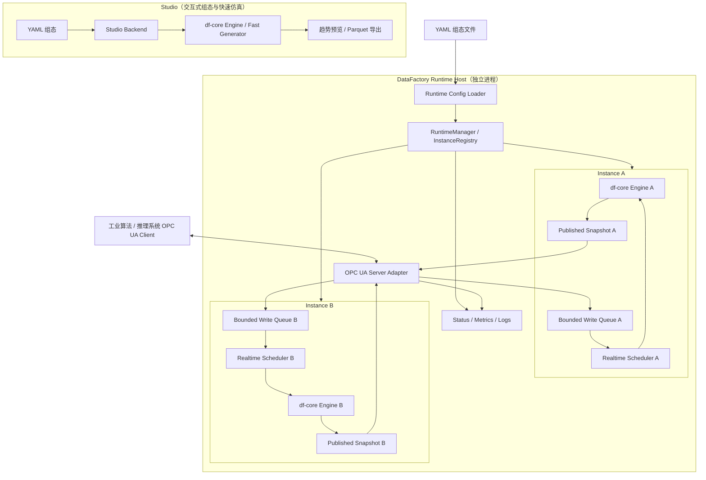
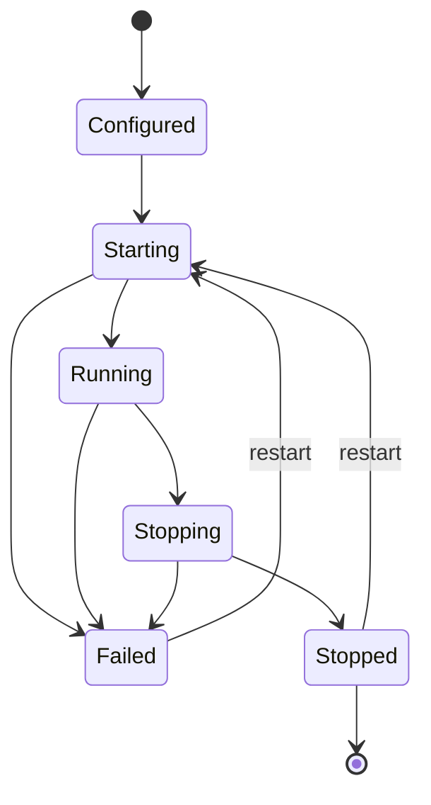
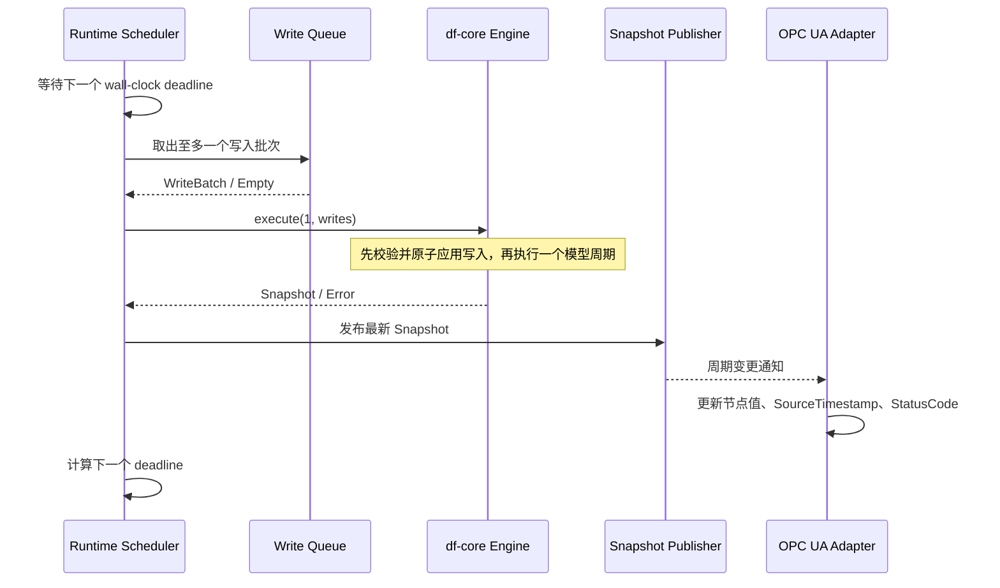
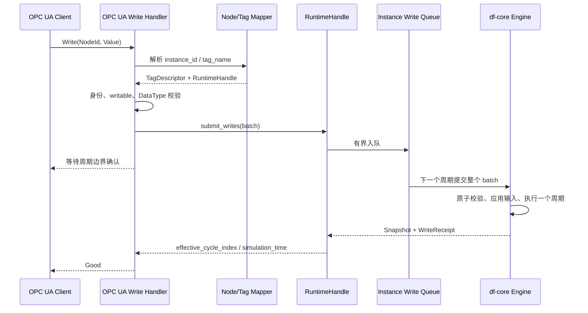

# DataFactory Runtime 多实例与 OPC UA 闭环系统设计

> 文档状态：设计基线 v1.0  
> 更新日期：2026-11-02  
> 适用分支：`main`  
> 设计对象：Rust Engine、Runtime CLI、Runtime Host、多组态实例管理、OPC UA 实时数据发布与闭环写入  
> 说明：本文是后续实现的技术设计和验收依据，不代表文中规划功能已经实现或通过测试。

## 0. 设计结论

DataFactory 必须保留两种不同但共享同一套模型计算核心的运行方式：

1. **快速生成（Fast / Generator）**：不等待真实时间，按模型周期连续计算，快速生成长周期数据集。Studio 使用该能力进行组态调整、趋势预览和数据导出。
2. **实时运行（Realtime Runtime）**：模型计算与真实时间调度同时运行，Runtime 直接执行模型，并通过 OPC UA 发布当前周期数据、接收外部写入。写入进入模型运行状态，在后续模型计算中产生实际影响。

实时运行不是“先生成离线数据集，再通过 OPC UA 播放”。离线数据回放即使未来增加，也只是第三种补充数据源，不能替代实时闭环 Runtime。

核心架构原则：

- Studio 和 Runtime 共享 `df-core` 的 Compiler、Engine、组件实现和计算语义。
- Runtime 是独立进程，不依赖 Studio 前端；一份 Runtime 配置可以启动多份相互隔离的 YAML 组态。
- 一个 Runtime Host 使用一个 OPC UA Server Endpoint；每个组态实例拥有独立的 Engine、周期时钟、变量状态、写入队列和运行状态。
- OPC UA 写入必须经过 Runtime 的统一写入队列，并在模型周期边界应用；OPC UA 节点缓存不能成为第二份模型状态。
- AI Agent 负责理解需求和生成 YAML 组态；DataFactory 负责标准化编译、计算、实时发布和闭环写入。Agent 不生成临时代码替代 Engine。

## 1. 目标、范围与非目标

### 1.1 本次设计目标

| 编号 | 目标 | 结果 |
|---|---|---|
| G-01 | Runtime 脱离 Studio 独立启动 | 通过 CLI 加载一份或多份组态 |
| G-02 | 多组态独立运行 | 每个实例独立维护模型状态和仿真时间 |
| G-03 | 双时间运行 | 快速生成不等待墙上时钟；实时运行按周期调度 |
| G-04 | OPC UA 实时发布 | 客户端可浏览、读取、订阅过程变量 |
| G-05 | OPC UA 闭环写入 | 外部写入进入模型，影响后续计算和过程变量 |
| G-06 | 可观测、可诊断 | 查看实例状态、周期耗时、超时、写入拒绝和通信状态 |
| G-07 | 可复现、可验收 | 有自动化测试、独立 OPC UA Client 验证和运行证据 |

### 1.2 本次不解决的问题

- 不把 DataFactory 定位成生产 DCS、PLC 或安全联锁系统；Runtime 面向工业算法/时序模型的隔离测试环境，不承担真实生产装置的安全控制责任。
- 不实现跨实例变量连接。默认实例之间完全隔离；后续如需联动，必须单独设计显式连接机制。
- 不通过动态加载任意 DLL 或脚本实现组件扩展。新增组件按现有规范扩展组件定义、Compiler 和 Engine。
- 不把当前测试任务的被测算法自动加入该任务的数据生成组件。只有当某算法在另一个测试场景中充当被测对象的运行环境或关联模型时，才作为该场景的模拟组件。
- 不将离线数据集回放作为实时闭环能力的替代品。
- Monitor UI、报警和历史归档属于可维护性能力，纳入后续阶段，不阻塞 Runtime + OPC UA 闭环主链路。

## 2. 当前代码基线与差距

本节按当前分支代码描述事实。实现状态以代码和测试结果为准，不以 TODO 或设计文档作为已完成证据。

### 2.1 已有能力

| 模块 | 当前代码能力 | 相关位置 |
|---|---|---|
| 模型编译 | DSL v2 YAML 编译为带版本头的 `.dfproject` | `crates/df-core/src/compiler.rs` |
| 模型执行 | Engine 持有 Tag 值、Slot 映射和组件内部状态 | `crates/df-core/src/engine.rs` |
| 时间语义 | `simulation_time = cycle_index × cycle_time` | `crates/df-core/src/engine.rs` |
| 快速仿真 | `simulate` / `generate` 不等待真实时间 | `crates/df-core/src/engine.rs` |
| 写入校验 | Tag 存在、可写和类型校验；整批先校验再应用 | `Engine::validate_writes` |
| Tag 元数据 | 名称、类型、可写属性、单位、说明、初值 | `TagDescriptor` |
| Runtime 调度 | 单个 Engine、独立调度线程、Delay/CatchUp | `crates/df-runtime/src/lib.rs` |
| Runtime 写入 | 有界 FIFO 队列；每周期最多处理一个写入批次 | `Runtime::submit_writes` |
| Runtime 快照 | 对外发布最近一次成功周期的 Snapshot | `Runtime::snapshot` |
| Runtime CLI | 启动一份已编译 `.dfproject`；stdin 支持 status/snapshot/stop | `crates/df-runtime/src/main.rs` |

### 2.2 当前明确缺失

1. 没有 Runtime Host/Manager，不能在一个进程内管理多份组态。
2. Runtime CLI 目前只接受单个 `.dfproject`，没有 Runtime Host 配置文件，也没有直接加载 YAML 的流程。
3. 没有 OPC UA Server、Namespace、NodeId 映射、订阅发布或 OPC UA 写入适配层。
4. 当前 Snapshot 只包含周期序号、仿真时间和变量值，没有逐 Tag Quality 或真实时间戳。
5. Runtime 没有向 OPC UA 适配层提供周期变更通知；当前只有读取最新 Snapshot 的接口。
6. 当前 Runtime 状态没有公开队列深度、周期实际开始时间和调度抖动。
7. 尚未完成工作区编译、自动化测试和 Windows 真实运行验收。

### 2.3 重要的现有语义约束

- `Engine::execute(1, writes)` 会先校验并应用写入，再执行一个模型周期；成功后周期序号增加。
- 写入批次中任一 Tag 不存在、不可写或类型不匹配时，整批拒绝，不会部分应用。
- 当前 Runtime 收到写入拒绝后，会以空写入继续执行该墙上时钟周期，避免非法写入使模型少推进一个周期。
- 当前 Runtime 每个模型周期最多取出一个写入批次。多个批次按队列顺序进入后续周期，不会在一个周期内合并。
- 当前 `Runtime::stop()` 会拒绝尚未生效的排队写入，不承诺将其排空执行。
- 当前 DSL Compiler 读取 `clock.cycle_time`，但没有把 `clock.mode` 编译为运行模式。运行模式应由宿主选择：Studio 直接快速执行，Runtime 使用实时调度；不能依赖当前未被 Compiler 消费的 `clock.mode`。

## 3. 总体架构

### 3.1 逻辑架构



### 3.2 模块职责

| 模块 | 主要职责 | 不负责 |
|---|---|---|
| `df-core` | DSL 编译、组件计算、模型状态、单周期推进、Tag 校验 | 墙上时钟、网络协议、UI |
| `df-runtime::Runtime` | 单实例周期调度、写入队列、Snapshot 发布、实例状态 | OPC UA 协议和多实例生命周期 |
| `RuntimeManager` | 加载多份配置、创建/停止/重启实例、实例注册和隔离 | 组件计算 |
| `RuntimeConfig` | 定义 Server、实例、项目路径、调度策略和安全配置 | 模型内部参数 |
| `OpcUaAdapter` | NodeId 映射、读/订阅、写入转换、身份与访问控制 | 直接修改 Engine |
| `Runtime CLI` | check/run/status/stop 等操作入口 | Studio UI |
| `Monitor/Archive` | 指标、日志、报警和历史留存 | 改变模型计算结果 |

### 3.3 进程与线程边界

首版建议采用单 Runtime Host 进程：

- 每个模型实例一个 Engine 和一个 Runtime 调度工作线程。
- OPC UA Server 使用独立异步任务运行，不在 Engine 周期线程中执行网络 I/O。
- Runtime Host 主线程负责配置、生命周期、CLI 和全局状态。
- OPC UA 读请求只读取已发布 Snapshot；写请求只调用 Runtime 写入接口。
- 归档、日志和其他慢消费者不得阻塞 Engine 周期线程。

Engine 周期线程独占该实例的可变模型状态。外部线程不持有 Engine 的可变引用。

## 4. Runtime Host 配置设计

### 4.1 配置文件示例

建议新增独立的 Runtime Host YAML，例如 `runtime.yaml`。它与模型组态 YAML 分离：前者描述运行实例和服务，后者描述模型本身。

```yaml
runtime_version: 1

opcua:
  enabled: true
  endpoint_url: "opc.tcp://127.0.0.1:4840"
  application_uri: "urn:datafactory:runtime"
  namespace_uri: "urn:datafactory:runtime"
  security:
    mode: SignAndEncrypt
    policy: Basic256Sha256
    allow_anonymous: false
    server_certificate: "./cert/server.der"
    server_private_key: "./cert/server-key.pem"
    trust_list: "./cert/trusted"

instances:
  - id: tank-a
    project: "./projects/two_tank_pid.yaml"
    enabled: true
    scheduler:
      overrun_policy: delay
      write_queue_capacity: 256

  - id: tank-b
    project: "./projects/two_tank_pid.yaml"
    enabled: true
    scheduler:
      overrun_policy: catch_up
      write_queue_capacity: 256
```

说明：

- `project` 可以指向 DSL v2 YAML 或已编译的 `.dfproject`。
- 相对路径以 Runtime Host 配置文件所在目录为基准，不以当前工作目录为基准。
- 相同项目文件可以启动多次；每次加载都创建新的 Engine，初始值和内部状态彼此独立。
- `id` 是 Runtime 实例唯一标识，建议限制为 1–64 位字母、数字、下划线和连字符，区分大小写。
- `write_queue_capacity` 是写入批次数量上限，不是 Tag 数量上限。
- 默认 `overrun_policy` 为 `delay`。未配置的实例参数使用统一默认值。
- 配置结构应使用严格反序列化，未知字段、重复实例 ID、无效路径和非法端点必须在启动前报告。

### 4.2 配置校验规则

| 校验项 | 规则 | 失败处理 |
|---|---|---|
| runtime_version | 必须为受支持版本 | Host 启动失败 |
| instance.id | 非空、格式合法、全局唯一 | Host 启动失败 |
| project | 文件存在且扩展名/格式受支持 | 对应实例 Failed；按启动策略决定是否继续 |
| scheduler | 周期策略有效，队列容量大于 0 | 对应实例 Failed |
| endpoint_url | URL 合法、协议为 opc.tcp | OPC UA 服务启动失败 |
| endpoint bind | 地址和端口可绑定 | Host 启动失败并回滚已启动实例 |
| security | 非回环网卡不得使用不安全配置 | Host 启动失败 |

### 4.3 YAML 与 dfproject 加载

加载顺序：

1. `.yaml/.yml`：读取源文件，调用 `df_core::compile_source` 得到编译字节，再调用 `Engine::from_bytes` 创建 Engine；首版不强制生成临时文件。
2. `.dfproject`：调用 `Engine::load` 读取编译产物。
3. 其他扩展名：明确报错，不按内容猜测格式。

这使 Runtime 可直接运行 Agent 生成的 YAML，也保留已编译产物部署方式。正式发布时可选用固定版本的 `.dfproject`，避免生产启动时执行源文件编译。

## 5. 多实例管理设计

### 5.1 实例隔离模型

每个实例独立拥有：

- 一个 Engine 及其全部 Tag 值。
- 一套组件内部状态，例如 PID 积分/微分状态、Lag 缓冲区、随机数状态。
- 一个仿真周期序号和仿真时间轴。
- 一个实时调度线程及独立截止时间。
- 一个有界写入队列。
- 一个最近 Snapshot 和实例级状态统计。
- 一份 Tag Catalog 和 OPC UA Node 映射。

实例之间不得共享 Engine、Tag Slot、PID 状态、Lag 缓冲区、写入队列或周期计数器。

### 5.2 管理接口

建议提供以下管理能力：

| 接口 | 行为 |
|---|---|
| `load_config(path)` | 解析并校验 Host 配置 |
| `start_all()` | 启动所有 enabled 实例 |
| `start_instance(id)` | 启动指定实例 |
| `stop_instance(id)` | 停止指定实例并拒绝未生效写入 |
| `restart_instance(id)` | 从原始配置重新加载，状态回到初始值 |
| `get_instance(id)` | 返回只读 RuntimeHandle |
| `list_instances()` | 返回实例 ID、状态和基础指标 |
| `shutdown()` | 停止接收新请求，停止所有实例并关闭服务 |

实现时将生命周期所有权与只读访问分离：

- Manager 持有 Runtime Owner，负责 stop/join。
- UA Adapter 获取可 Clone 的 RuntimeHandle，只能读取状态/Snapshot 和提交写入。
- UA 回调不得持有 Manager 的全局写锁等待一个模型周期。
- 实例注册表使用短时读锁查找 Handle；模型执行不持有注册表锁。

### 5.3 启动与故障隔离策略

推荐默认策略：

- Runtime Host 配置语法错误、重复 ID、OPC UA Endpoint 无法绑定：Host 启动失败。
- 单个实例项目编译失败或 Engine 初始化失败：该实例标记 Failed，记录错误；其他实例继续启动。
- 一个实例运行中发生 Engine 致命错误：仅该实例进入 Failed，拒绝其后续写入；其他实例继续运行。
- OPC UA Server 是 Host 级公共服务；服务启动失败时回滚所有已启动实例。运行期间 Server 发生不可恢复故障时，Host 进入 Failed 并按顺序停止全部实例。
- 重启实例创建全新的 Engine，恢复 YAML/dfproject 中的初始值，不承诺从上次运行位置恢复。

### 5.4 生命周期状态



状态含义：

- Configured：配置已解析，实例尚未启动。
- Starting：正在编译/加载项目并初始化 Engine。
- Running：调度器正常工作。
- Stopping：停止请求已发出，当前周期结束后清理资源。
- Stopped：实例已停止，未处理写入已拒绝。
- Failed：实例发生不可恢复错误，不能继续推进模型周期。

## 6. 双时间机制与实时调度

### 6.1 时间定义

| 时间量 | 定义 | 归属 |
|---|---|---|
| `cycle_time` | 模型每执行一个周期代表的物理时间，单位秒 | Project / Engine |
| `cycle_index` | 已成功完成的模型周期数 | Engine |
| `simulation_time` | `cycle_index × cycle_time` | Engine |
| `wall_clock` | 操作系统单调时钟，用于等待和调度 | Runtime |
| `published_at` | Snapshot 完成并发布时的 UTC 时间 | Runtime/OPC UA |

仿真时间必须保持确定性，不使用系统时间参与组件公式。墙上时钟只决定何时调用 Engine。

### 6.2 两种执行模式

| 维度 | Fast / Generator | Realtime Runtime |
|---|---|---|
| 计算核心 | 同一 df-core Engine | 同一 df-core Engine |
| 周期推进 | 连续调用，不等待 | 按 cycle_time 调度 |
| 时间来源 | Engine 虚拟时间 | Engine 虚拟时间 + Runtime 墙上时钟 |
| 输出 | Snapshot、Parquet 等离线结果 | 实时 Snapshot、OPC UA 节点 |
| 外部写入 | 由离线任务输入或测试脚本提供 | OPC UA/其他适配器提交至 Runtime |
| 主要用途 | 快速生成长周期数据、调试特征 | 给推理系统提供实时闭环过程数据 |

同一份模型组态可以由两种宿主运行。两者差异只在调度和数据接口，不允许复制一套组件公式。

### 6.3 周期执行时序



规则：

1. Runtime 启动后先读取初始 Snapshot；首个模型周期在第一个 wall-clock 周期到达时执行。
2. 每次调度最多推进一个模型周期，成功后 `cycle_index` 增加 1。
3. 写入批次在该周期的计算开始前应用，因此其影响该次周期计算以及之后的周期。
4. 一个周期最多应用一个写入批次；队列中的其他批次留待后续周期。
5. Snapshot 在 Engine 完成周期后一次性发布；外部读者只看到上一个完整 Snapshot 或新 Snapshot，不看到中间计算状态。
6. OPC UA 更新在 Snapshot 发布之后执行，不能反向阻塞 Engine 周期线程。

### 6.4 超时策略

| 策略 | 行为 | 适用场景 |
|---|---|---|
| Delay | 当前周期结束后，再等待一个完整 cycle_time | 默认；避免过载时连续占用 CPU 追赶 |
| CatchUp | 保持原始墙上时钟时间表；落后时立即执行逾期周期 | 短时抖动后希望追赶实时节拍 |

两种策略都不跳过模型周期。CatchUp 可能连续执行多个周期；如果持续计算能力不足，仍无法追上实时节拍。Runtime 必须记录：

- 最近一次和最大周期计算耗时。
- 超过 cycle_time 的周期数。
- 错过的 wall-clock deadline 数。
- 最近周期开始时间、结束时间和调度延迟。
- 当前写入队列深度及拒绝数量。

Windows 普通进程调度属于软实时，不承诺硬实时确定性。若目标周期小于系统和模型的实际执行能力，必须通过指标暴露超时，不允许通过跳周期伪装正常运行。

## 7. OPC UA Server 设计

### 7.1 Server 形态

首版使用一个 Runtime Host 对应一个 OPC UA Server Endpoint：

- 多个模型实例共享同一个 Endpoint。
- 每个实例在地址空间中拥有独立 Folder。
- 一个实例停止或失败，不影响其他实例的 NodeId。
- 不为每个 YAML 单独占用一个端口。
- UA Server 与 Runtime 在同一进程，但网络事件循环与 Engine 周期线程分离。

### 7.2 地址空间

建议结构：

```text
Objects
└── DataFactory
    ├── ServerStatus
    │   ├── State
    │   ├── InstanceCount
    │   └── RunningInstanceCount
    └── Instances
        ├── tank-a
        │   ├── Status
        │   │   ├── State
        │   │   ├── CycleTime
        │   │   ├── CycleIndex
        │   │   ├── SimulationTime
        │   │   ├── LastCycleDurationMs
        │   │   ├── OverrunCount
        │   │   ├── MissedDeadlines
        │   │   └── RejectedWriteBatches
        │   └── Tags
        │       ├── source_flow
        │       ├── pid2.PV
        │       ├── pid2.SV
        │       └── tank_2.level
        └── tank-b
            ├── Status
            └── Tags
```

首版 Tag 节点放在实例的 `Tags` 文件夹下，BrowseName 使用完整 Tag 名称（例如 `tank_2.level`），避免自行拆分点号造成名称歧义。后续如有必要再增加组件层级 Folder，但不能改变既有 NodeId。

### 7.3 Namespace 与 NodeId

- Namespace URI 使用固定值，例如 `urn:datafactory:runtime`。
- NodeId 使用字符串标识，包含实例 ID 和完整 Tag 名称。
- 建议格式：`df/instances/{instance_id}/tags/{percent_encoded_tag_name}`。
- 实例状态节点使用 `df/instances/{instance_id}/status/{status_name}`。
- NodeId 不包含动态 Namespace Index；客户端应通过 Namespace URI 解析索引。
- 同一实例 ID 和 Tag 名称在重启后应生成相同 NodeId。
- 两个实例即使加载同一份 YAML，也必须有不同 NodeId。

### 7.4 Tag 类型与元数据映射

| DataFactory Tag 类型 | OPC UA DataType | 说明 |
|---|---|---|
| BOOL | Boolean | 布尔值 |
| INT64 | Int64 | 有符号 64 位整数 |
| FLOAT64 | Double | 64 位浮点数 |
| STRING | String | 字符串 |

TagDescriptor 元数据映射：

- `name` → BrowseName / DisplayName。
- `description` → Description。
- `unit` → 工程单位属性（库支持时使用标准 EUInformation；否则保留为 Description/自定义属性，不能丢失）。
- `writable` → AccessLevel / UserAccessLevel 的基础权限。
- `data_type` → Variable DataType。
- `initial` → 初始 Value。

当前 TagDescriptor 没有 min/max、精度、枚举集合等约束，因此首版不虚构范围校验。若后续增加范围限制，应同步扩展 DSL、TagDescriptor、编译产物版本和 Engine 写入校验，不能只在 OPC UA 层单独维护一份约束。

### 7.5 读取、订阅与 Snapshot 发布

读取流程：

1. OPC UA Read 根据 NodeId 查找实例和 Tag。
2. 读取该实例最近一次已发布 Snapshot。
3. 按 TagDescriptor 类型转换为 OPC UA Variant。
4. 返回 Value、SourceTimestamp 和 StatusCode。

订阅流程：

- Engine 每成功执行一个周期，发布一次 Snapshot revision。
- Snapshot Publisher 通知 OPC UA Adapter 有新周期。
- Adapter 批量更新该实例所有对外暴露节点或本次变更节点。
- OPC UA Subscription 由 Server 协议栈负责采样、过滤和通知。
- UA 慢客户端不能反向阻塞 Engine；允许 UA Subscription 按协议队列策略丢弃旧通知，但不能影响 Engine 计算。

首版 Snapshot 的 SourceTimestamp 使用 Runtime 记录的 Snapshot 发布 UTC 时间；`simulation_time` 和 `cycle_index` 作为实例状态变量独立暴露。不能把仿真秒数伪装成 OPC UA DateTime。

当前 Engine 没有逐 Tag Quality。首版只根据实例状态设置基础状态码：

- Starting：BadWaitingForInitialData。
- Running 且 Snapshot 有效：Good。
- Stopped/Failed：BadOutOfService。

不得在没有组件级质量计算机制时，伪造每个 Tag 的独立质量状态。

## 8. OPC UA 闭环写入设计

### 8.1 写入权限来源

写入权限以模型 Tag Catalog 为准，不以 OPC UA 节点缓存或客户端声明为准。

- `TagDescriptor.writable = true`：允许进入下一步的身份权限检查。
- `writable = false`：必须拒绝写入。
- 用户身份必须拥有写角色；节点可写不代表所有身份都能写。
- 服务端回调必须重复执行权限检查，不能只依赖地址空间的 AccessLevel 显示。

当前 PID 节点的 PV/SV/MV/MODE 是 Compiler 根据 PID 组件生成的状态 Tag，当前实现均为只读。需要外部改变 PID 设定值时，应增加一个独立、可写的 Variable，并将其连接到 PID 的 SV 输入，而不是直接开放 PID 内部状态。

示例：

```yaml
- name: level_setpoint
  type: Variable
  value: 0.8
  writable: true

- name: pid2
  type: PID
  params:
    PB: 30.0
    TI: 90.0
    TD: 20.0
    SV: 0.8
    MV: 0.0
  inputs:
    PV: tank_2.level
    SV: level_setpoint
```

这样 OPC UA Client 写入 `level_setpoint`，Runtime 在下一个模型周期应用该值，PID 随后按新的设定值计算，阀门和水箱模型继续产生响应。

### 8.2 写入处理链路



### 8.3 写入批次规则

- 同一 OPC UA Write 服务请求中，属于同一个实例的多个 Tag 写入合并为一个 Runtime 写入批次。
- 一个批次必须原子应用；任一 Tag 不存在、只读或类型不匹配，整批拒绝。
- 一个 OPC UA 请求同时写入多个实例时，按实例拆分批次；不同实例之间不承诺跨实例事务原子性。
- 不同客户端或不同 Write 请求产生的批次按 Runtime 队列实际接收顺序处理。
- 当前 Runtime 每周期最多应用一个批次；同一个 Tag 的连续写入不会在同一周期内覆盖合并，而是依次进入后续周期。
- 队列已满时立即拒绝，不覆盖旧值、不静默丢弃。
- 成功响应应在 Engine 确认实际生效后返回，而不是仅在写入进入队列时返回 Good。
- WriteReceipt 中的 `effective_cycle_index` 和 `simulation_time` 是写入生效的证据；Runtime 应记录请求 ID、来源身份、Tag、值、接收时间、结果和生效周期。

### 8.4 写入响应与错误映射

| 场景 | OPC UA 结果建议 | 处理 |
|---|---|---|
| Tag 不存在 | BadNodeIdUnknown | 不入队 |
| Tag 不可写 | BadNotWritable | 不入队 |
| 身份无写权限 | BadUserAccessDenied | 不入队 |
| DataType 不匹配 | BadTypeMismatch | 不入队 |
| 写入队列满 | BadServerTooBusy | 不入队 |
| 实例已停止 | BadShutdown / BadOutOfService | 不入队 |
| Engine 拒绝整批写入 | 对应写操作返回相应 Bad 状态 | 整批不应用 |
| 写入已在周期边界生效 | Good | 返回成功 |

### 8.5 写入等待、超时和取消

当前 `WriteTicket::wait(timeout)` 超时只表示调用方等待超时，不会取消队列中的写入。该行为不能被误解为“写入没有发生”。

OPC UA Adapter 实现时必须处理这个边界：

1. 写服务端等待 WriteTicket 的时间应覆盖一个完整 cycle_time、周期计算时间和合理通信余量。
2. 适配层应增加写入请求 ID 和可查询的写入状态，至少区分 Queued、Applying、Applied、Rejected、Cancelled。
3. 若客户端请求取消，只有尚未开始应用的 Queued 批次才允许取消；进入 Applying 后不能承诺撤销。
4. 如果请求超时发生在 Applying 阶段，记录为结果不确定，并允许通过诊断接口查询最终结果；不得声称一定未生效。
5. 停止实例时，尚未应用的批次统一拒绝并返回停止错误。

因此，OPC UA 客户端应将写入设置为绝对设定值，不应把“增加 1”“触发一次”这类非幂等动作伪装成普通 Tag 赋值。

## 9. OPC UA 安全设计

### 9.1 基础要求

- Endpoint 默认绑定 `127.0.0.1`，避免初次启动即暴露到局域网。
- 需要局域网访问时，必须显式配置监听地址。
- 非回环地址禁止使用 SecurityPolicy None。
- 正式测试环境使用 Sign 或 SignAndEncrypt；优先 SignAndEncrypt。
- 服务端必须支持服务器证书、私钥和客户端信任列表管理。
- 生产/共享测试环境禁止默认匿名写入。
- 用户名、密码等秘密不得明文写入 Runtime YAML；使用环境变量或受保护的凭据存储。
- 读权限和写权限分离；写入权限同时受 OPC UA 身份角色和 Tag writable 属性限制。
- 记录客户端身份、会话、写入目标和写入结果，避免记录明文密码或私钥。

具体 SecurityPolicy 和证书格式以 OPC UA 库的实际支持能力为准，完成兼容性测试后再固定产品默认值。

### 9.2 Rust OPC UA 库选型

当前仓库没有 OPC UA Rust 依赖。建议将 `async-opcua 0.19.x` 作为首选 PoC 候选，而不是在未验证前直接锁定为最终依赖：

- 提供 OPC UA Server API、地址空间/Node Manager、Subscription 等能力。
- Server 采用异步任务模型，适合与 Runtime 周期线程分离。
- 0.19.0 版本资料显示其发布于 2026-07-18，采用 MPL-2.0；项目说明其 MSRV 目标为最新 stable Rust。
- 该项目仍处于 0.x 阶段，API 可能存在破坏性变化；MPL-2.0 对闭源产品的适用影响需要法务确认。

PoC 必须先验证：Windows 编译、目标安全策略、证书加载、匿名/用户名认证、动态节点创建、变量读写回调、订阅更新和关闭释放。通过后再固定具体版本和 Cargo feature。

参考：
- https://docs.rs/crate/async-opcua/0.19.0
- https://docs.rs/async-opcua/0.19.0/opcua/server/index.html
- https://github.com/FreeOpcUa/async-opcua/blob/master/docs/server.md

### 9.3 异步边界

OPC UA 协议栈使用 Tokio 等异步运行环境时：

- 不得在 Tokio 核心工作线程中直接阻塞等待 Runtime 的同步 WriteTicket。
- 使用专用阻塞任务或异步桥接等待写入确认。
- Engine 周期线程不得执行 UA 网络发送、证书读写或客户端回调。
- OPC UA 服务线程不得直接获得 Engine 可变引用。
- UA Server 关闭时先停止接受新请求，再关闭实例和释放服务资源。

## 10. 状态、监控与日志

### 10.1 实例级状态指标

至少提供：

| 指标 | 含义 |
|---|---|
| State | 实例生命周期状态 |
| CycleTime | 模型周期，秒 |
| CycleIndex | 已完成周期数 |
| SimulationTime | 仿真时间，秒 |
| LastExecutionDurationMs | 最近周期计算耗时 |
| MaxExecutionDurationMs | 最大周期计算耗时 |
| OverrunCount | 执行耗时超过周期的次数 |
| MissedDeadlines | 错过的墙上时钟截止点数 |
| WriteQueueDepth | 当前排队批次数 |
| RejectedWriteBatches | 被拒绝的写入批次数 |
| LastWriteError | 最近一次写入错误 |
| LastError | 最近一次实例级致命错误 |

### 10.2 Host/OPC UA 级指标

- OPC UA Server State、Endpoint、当前会话数和订阅数。
- 每个实例的连接客户端数（如协议栈可可靠提供）。
- OPC UA Read/Write 请求数、失败数和响应耗时。
- 写入队列满次数。
- 实例启动失败数和运行失败数。

### 10.3 报警与历史归档边界

首轮 Runtime + OPC UA 闭环不强制实现完整报警/历史库。后续 P1 再增加：

- 周期超时、实例 Failed、队列持续满、OPC UA 服务不可用等报警。
- 报警产生、确认、恢复和历史查询。
- 按实例/Tag 配置采样归档，记录 UTC 时间、cycle_index、simulation_time、Value 和 Quality。
- 归档使用独立有界缓冲和后台线程；归档变慢不得阻塞 Engine。
- 归档缓冲满时按明确策略报警并记录丢弃数量，不能静默丢数。

## 11. 异常处理与资源释放

| 异常 | 实例/Host 行为 | 对外表现 |
|---|---|---|
| YAML 语法错误 | 对应实例启动失败 | 配置错误和文件位置 |
| dfproject 版本不兼容 | 对应实例启动失败 | 格式/ABI 不支持 |
| Engine 计算致命错误 | 实例 Failed，停止继续推进 | 节点 BadOutOfService，LastError 更新 |
| 外部写入非法 | 拒绝整批；本周期继续空写入推进 | Write 返回 Bad，拒绝计数增加 |
| 写入队列满 | 不入队 | BadServerTooBusy |
| 单实例停止 | 仅停止该实例 | 对应节点停止更新，其他实例继续 |
| OPC UA 启动失败 | Host 回滚所有已启动实例 | 进程非零退出 |
| OPC UA 运行时不可恢复故障 | Host 进入 Failed，停止所有实例 | 记录 Host 级故障 |
| 用户 Ctrl+C / Stop | 停止接收新写入，停止实例，关闭 UA Server | 优雅退出 |
| Engine 周期线程 Panic | 捕获 Panic，实例 Failed；不能让状态永久显示 Running | 诊断日志和 Bad 状态 |

停止顺序：

1. Host 进入 Stopping，禁止新实例启动。
2. OPC UA Adapter 停止接收新的写请求。
3. 对仍在 Queued 状态的写入返回停止错误；不再应用新批次。
4. 等待当前正在执行的 Engine 周期结束。
5. 停止所有 Runtime Worker，回收线程。
6. 关闭 OPC UA Server 和会话。
7. 刷新并关闭日志/归档资源。
8. Host 进入 Stopped，返回退出码。

进程内线程无法被安全强杀。若未来引入可能无限执行的用户算法，必须增加执行预算和进程级隔离；不能假设线程超时就能安全终止算法。

## 12. CLI 设计

### 12.1 命令

保留现有单项目命令兼容性，同时增加 Host 配置模式：

| 命令 | 行为 |
|---|---|
| `df-runtime run project.dfproject` | 启动单实例，兼容现有 CLI |
| `df-runtime check --config runtime.yaml` | 只校验 Host 配置、项目编译和 Node 映射，不启动周期调度 |
| `df-runtime run --config runtime.yaml` | 启动多实例 Host 和 OPC UA Server |
| `df-runtime version` | 输出 Runtime、Project Format 和 Engine ABI 版本 |

交互控制台建议支持：

- `status`：列出全部实例状态。
- `status <instance_id>`：查看指定实例指标。
- `snapshot <instance_id>`：查看指定实例最新 Snapshot。
- `stop <instance_id>`：停止指定实例。
- `stop`：停止整个 Host。

正式部署时 Runtime 以前台服务进程运行，Ctrl+C/系统停止信号触发统一关闭流程。stdin 控制台用于开发和人工测试，不作为唯一的生产管理接口。

### 12.2 退出码

| 退出码 | 含义 |
|---:|---|
| 0 | 正常停止 |
| 1 | 未分类运行错误 |
| 2 | 参数或配置错误 |
| 3 | 项目编译/加载失败 |
| 4 | OPC UA 服务启动失败 |
| 5 | Host 运行中发生不可恢复错误 |

## 13. 实现拆分与文件规划

建议按职责增量拆分，不重写现有 Engine。

| 迭代 | 主要任务 | 目标文件/模块 |
|---|---|---|
| R1 | RuntimeHandle、Runtime Owner、Snapshot revision/通知、写入状态 | `crates/df-runtime/src/lib.rs`、`runtime_handle.rs` |
| R2 | Host 配置结构、严格解析、路径处理、配置预检查 | `config.rs`、`loader.rs` |
| R3 | RuntimeManager、多实例生命周期和故障隔离 | `manager.rs`、`instance.rs` |
| R4 | CLI 的 check/run --config、多实例状态和优雅停止 | `crates/df-runtime/src/main.rs`、`cli.rs` |
| R5 | OPC UA 库 PoC、Server 启停和安全配置 | `opcua/mod.rs`、Cargo feature |
| R6 | Tag Catalog 到 NodeId/Variant/AccessLevel 映射 | `opcua/address_space.rs`、`opcua/value.rs` |
| R7 | Snapshot 周期发布、订阅通知 | `opcua/publisher.rs` |
| R8 | OPC UA Write Handler、批次聚合、确认和取消 | `opcua/write.rs`、Runtime 写入接口 |
| R9 | 双水箱闭环案例和独立客户端自动化测试 | `tests/runtime_multi_instance.rs`、`tests/opcua_closed_loop.rs` |
| R10 | Monitor 指标、报警、归档 | 后续独立迭代 |

建议保持 `df-core` 不依赖 OPC UA。OPC UA 是 Runtime 的外部适配层，不进入组件计算代码。

## 14. 验收标准

所有验收项必须有测试脚本或可复现的操作记录。仅启动成功、能浏览几个节点，不等于闭环验收通过。

### 14.1 配置和 CLI

| ID | 验收点 | 操作 | 通过标准 |
|---|---|---|---|
| CFG-01 | 配置解析 | 使用有效 runtime.yaml 执行 check | 返回 0，列出实例和项目路径 |
| CFG-02 | 重复 ID | 配置两个相同 instance_id | 启动前拒绝，指出重复 ID |
| CFG-03 | 路径解析 | 从不同工作目录启动相对路径配置 | 均按配置文件目录正确解析 |
| CFG-04 | 项目格式 | 分别使用 YAML、dfproject | 两种格式均能加载；不支持格式明确报错 |
| CLI-01 | 脱离 Studio | 关闭 Studio，仅执行 Runtime CLI | 实例正常启动并持续运行 |
| CLI-02 | 单实例兼容 | 使用旧命令运行 dfproject | 行为保持兼容 |
| CLI-03 | 优雅停止 | Ctrl+C 或 stop | 新写入停止接收，线程和 UA Server 正常退出 |

### 14.2 双时间和调度

| ID | 验收点 | 操作 | 通过标准 |
|---|---|---|---|
| CLK-01 | 模型时间正确 | cycle_time=0.5s，运行 20 个周期 | cycle_index=20，simulation_time=10.0s |
| CLK-02 | 实时节拍 | cycle_time=0.5s，运行 10 分钟 | 无跳过模型周期；记录每周期实际耗时和调度延迟 |
| CLK-03 | Fast 不等待 | 对同一项目快速执行 10000 周期 | 不按 0.5s 等待 10000 次；结果时间为 5000s |
| CLK-04 | Delay 超时 | 注入执行耗时大于周期的 Fake Engine | overrun/missed_deadlines 增加；不跳过 cycle_index |
| CLK-05 | CatchUp 超时 | 注入短时周期超时 | 保留原始节拍并连续追赶；不跳过模型周期 |
| CLK-06 | 计算一致性 | 同一初始项目、同一写入序列分别 Fast 和 Realtime 执行 | 相同周期边界的模型值一致，允许墙上时间不同 |

### 14.3 多实例

| ID | 验收点 | 操作 | 通过标准 |
|---|---|---|---|
| INS-01 | 多实例启动 | 一个配置启动两份相同 YAML | 两个实例均 Running |
| INS-02 | 状态隔离 | 只向 A 写入设定值 | B 的 Tag、PID 状态和 Snapshot 不变 |
| INS-03 | 时间隔离 | A/B 配置不同 cycle_time | 两个 cycle_index 按各自周期推进 |
| INS-04 | 故障隔离 | 让 A 项目加载失败或 Engine 进入 Failed | B 继续运行，Host 状态和 A 错误可查询 |
| INS-05 | 单实例停止 | stop A | A 停止，B 继续推进 |
| INS-06 | 重启 | restart A | A 从初始值重新运行，NodeId 不变 |
| INS-07 | 资源边界 | 启动配置允许数量上限之外的实例 | 按明确上限拒绝，不发生无界创建 |

### 14.4 OPC UA 地址空间与读取

| ID | 验收点 | 操作 | 通过标准 |
|---|---|---|---|
| UA-01 | Endpoint | 独立客户端连接 Endpoint | 成功建立会话 |
| UA-02 | Browse | 浏览 DataFactory/Instances | 能看到每个启用实例和 Tags 文件夹 |
| UA-03 | NodeId 稳定 | 重启 Host 后重新读取相同 Tag | 同一实例/Tag 的 NodeId 不变 |
| UA-04 | 实例隔离 | 两实例加载同名 Tag | NodeId 不冲突，值互不混淆 |
| UA-05 | 类型映射 | 读取 BOOL/INT64/FLOAT64/STRING | OPC UA DataType 与 TagDescriptor 一致 |
| UA-06 | 元数据 | 读取 Description/Unit | 配置的说明和单位可查 |
| UA-07 | 订阅更新 | 订阅一个周期变化的 Tag | 每个有效周期产生对应数据变化通知 |
| UA-08 | Snapshot 一致性 | 同时读取多个 Tag | 数据来自同一个已发布周期，不出现周期内混合状态 |
| UA-09 | 时间戳 | 读取 SourceTimestamp、SimulationTime、CycleIndex | UTC 时间戳有效；仿真时间和周期序号符合公式 |

### 14.5 OPC UA 闭环写入

| ID | 验收点 | 操作 | 通过标准 |
|---|---|---|---|
| WR-01 | 可写 Tag | 向 writable=true 的 Variable 写入合法值 | 写服务确认 Good；对应周期的模型输入值更新 |
| WR-02 | 只读保护 | 向 writable=false 的组件输出写入 | 返回 BadNotWritable；模型状态不变 |
| WR-03 | 类型校验 | 向 FLOAT64 节点写入 String | 返回 BadTypeMismatch；模型状态不变 |
| WR-04 | 未知节点 | 写入不存在的 NodeId | 返回 BadNodeIdUnknown |
| WR-05 | 原子批次 | 一个批次中混入一个合法和一个非法 Tag | 整批不应用；合法 Tag 不得部分改变 |
| WR-06 | 队列背压 | 人为降低周期并持续提交写入直至队列满 | 返回 BadServerTooBusy；已入队数据不被覆盖 |
| WR-07 | 写入确认 | 写入后等待 WriteResponse | 只有 Engine 确认实际生效后才返回 Good |
| WR-08 | 连续写入 | 对同一 Tag 连续提交多个批次 | 按入队顺序逐周期应用，不乱序、不静默合并 |
| WR-09 | 停止期间写入 | 停止实例时仍有待处理批次 | 未生效批次被拒绝，不在停止后偷偷应用 |
| CL-01 | 真实闭环 | OPC UA Client 写入 level_setpoint，PID 控制阀门和双水箱 | 设定值进入 Engine，后续 PID MV、阀门开度和水箱液位出现与模型逻辑一致的响应 |
| CL-02 | 闭环不是回放 | 运行中连续改变 setpoint，并读取过程变量 | 输出随当前模型计算变化；不是预先生成文件的固定序列 |
| CL-03 | 生效周期可追溯 | 读取 WriteReceipt/诊断记录 | 能查到请求 ID、目标 Tag、结果和 effective_cycle_index |

### 14.6 安全、稳定性和性能

| ID | 验收点 | 操作 | 通过标准 |
|---|---|---|---|
| SEC-01 | 默认监听范围 | 不配置监听地址启动 | 默认只监听回环地址 |
| SEC-02 | 非安全远程访问 | 将 Endpoint 暴露到非回环地址但配置 SecurityPolicy None | 配置检查拒绝启动 |
| SEC-03 | 证书信任 | 使用未信任客户端证书连接 | 按安全策略拒绝 |
| SEC-04 | 身份写权限 | 使用只读身份写 Tag | 返回 BadUserAccessDenied |
| REL-01 | 长时间运行 | 在固定基准机运行 30 分钟 | 无进程崩溃、无实例状态卡死、无周期序号倒退 |
| REL-02 | 资源释放 | 多次启动、停止、重启实例 | 线程、Socket、句柄无持续增长 |
| REL-03 | 慢客户端 | 客户端降低读取/订阅速度 | Engine 周期不被网络发送阻塞 |
| PERF-01 | 周期预算 | 在目标实例数和 Tag 数下采集 30 分钟指标 | P95 周期计算耗时低于 cycle_time 的 80%；P99 不超过 cycle_time；超限必须明确报告 |
| PERF-02 | 多实例扩展 | 依次测试 1/2/5/10 个实例 | 输出每档 CPU、内存、周期 P95/P99、超时次数，形成可声明容量上限的报告 |

性能验收必须记录 CPU、内存、操作系统、Rust 版本、实例数、Tag/Node 数、各实例 cycle_time 和运行时长。上述阈值是首轮目标，不代表未经实测的容量承诺；如果目标硬件不能达到，应根据实测结果确定受支持的实例上限和最小周期。

## 15. 推荐实施顺序与阶段出口

| 阶段 | 工作范围 | 阶段出口 |
|---|---|---|
| P0-A | RuntimeHandle、Snapshot 通知、写入状态 | UA/Host 可安全访问 Runtime，不持有 Engine 可变引用 |
| P0-B | Runtime YAML、配置校验、YAML/dfproject 加载 | check 命令能预检查所有实例 |
| P0-C | RuntimeManager、多实例启停与故障隔离 | 2 份以上组态独立运行 |
| P0-D | CLI Host 模式、优雅停止 | 不启动 Studio 即可运行多实例 |
| P0-E | OPC UA 库 PoC、Endpoint、证书和地址空间 | 独立客户端可连接、Browse、Read、Subscribe |
| P0-F | OPC UA Write、批次确认、取消和错误映射 | 写入确实进入 Engine 周期计算 |
| P0-G | 双水箱闭环自动化测试 | 完成 WR/CL 验收项 |
| P1 | Monitor、报警、历史归档 | 运行状态和历史数据可追溯 |
| P2 | 离线数据集实时回放 | 作为独立补充数据源，不替代闭环 Runtime |

任何阶段只有在代码、自动化测试和必要的端到端验证通过后，才可以在 TODO 中标记为完成。

## 16. 关键设计决策记录

| 决策 | 结论 | 原因 |
|---|---|---|
| 模型计算核心 | 继续使用 df-core Engine | 避免 Studio/Runtime 两套计算逻辑 |
| Runtime 与 Engine 关系 | 同进程直接调用 df-core | 减少每周期 IPC 和序列化开销 |
| 多实例模型 | 一个 Host 管理多个独立 Engine | 满足多组态同时运行且互不污染 |
| OPC UA Server 数量 | 一个 Host 一个 Endpoint | 简化端口、证书和客户端接入 |
| NodeId | Namespace URI + 实例 ID + Tag 名称 | 同名 Tag 不冲突且重启稳定 |
| 写入边界 | 周期开始前批次原子应用 | 避免组件计算中途状态变化 |
| 写入排队 | 每实例有界 FIFO | 保序、可背压，不静默覆盖 |
| Snapshot | 只读已完成周期的快照 | 避免外部观察到半周期状态 |
| 异步网络 | OPC UA 独立异步任务 | 网络慢客户端不阻塞 Engine |
| 离线回放 | 非核心、后续补充 | 不具备模型闭环写入能力 |

## 17. 设计验收与专利证据

这份设计文档本身不是实现证据。后续每个关键技术特征都要形成可复现材料：

| 技术特征 | 需要保留的证据 |
|---|---|
| 同一组态的快速生成与实时运行 | 相同 YAML、相同初始条件的 Fast/Realtime 对比结果 |
| 多组态实例隔离 | 多实例运行日志、相同 Tag 名称的独立 NodeId 和独立状态 |
| 周期边界闭环写入 | OPC UA Write 请求、WriteReceipt、生效周期和后续过程响应 |
| 可写 Tag 权限映射 | TagDescriptor、Node AccessLevel、拒绝写入的测试记录 |
| 实时数据发布 | OPC UA 订阅通知、SourceTimestamp、cycle_index 和 simulation_time |
| 超时处理 | Delay/CatchUp 的调度记录和周期序号证明 |
| 标准化组态执行 | Agent 生成 YAML、Compiler 诊断和 Engine 运行结果 |

技术交底书只能将已经实现并通过验证的能力写成现有实施方式。本文中尚未完成的内容应标记为设计方案或待实现，不得写成已经落地的事实。

---

## 附录 A：现有实现与目标设计的接口差异

| 现有接口/结构 | 目标补充 | 目的 |
|---|---|---|
| `Runtime::start` | 保留单实例启动接口 | 兼容现有用法 |
| `Runtime::snapshot` | 增加 Snapshot revision/订阅通知 | 让 UA 按周期更新，不高频轮询 |
| `Runtime::submit_writes` | 增加 request_id、状态查询和待处理取消 | 处理 UA 写入等待/超时 |
| `RuntimeStatus` | 增加 queue_depth、last_cycle_started_at、last_cycle_lag | 可观测性 |
| 单实例 Runtime | RuntimeManager + RuntimeHandle | 多组态管理 |
| CLI 单 dfproject | `run --config runtime.yaml` | Host 级启动 |
| TagDescriptor | 首版沿用现有字段 | 保持模型格式兼容 |
| OPC UA 不存在 | 增加 Adapter 和可选依赖 | 协议边界隔离 |

## 附录 B：实施注意事项

1. 不要为了多实例把 Engine 改成共享全局状态；每个实例必须独立创建 Engine。
2. 不要让 OPC UA Node Value 成为模型真实值；唯一真实状态在 Engine，UA 只是读写适配层。
3. 不要在 Engine 周期线程中执行网络 I/O、日志磁盘写入或慢消费者回调。
4. 不要在 OPC UA Write 请求入队时就返回成功；需要区分“已入队”和“已生效”。
5. 不要把 OPC UA 客户端请求超时解释为写入已取消；必须有写入状态和取消边界。
6. 不要因为一个实例 Failed 就默认停止其他实例；实例级故障必须隔离。
7. 不要为了追赶真实时间而跳过模型周期；超时必须通过指标暴露。
8. 不要把 Fast Generator、Realtime Runtime 和 Offline Playback 混成一个模糊的“播放模式”。
9. 不要把尚未实现的 Tag Quality、范围约束、报警和历史归档写成当前已有能力。
10. 不要在未通过 Windows 编译和独立 OPC UA Client 验证前，将 OPC UA 闭环标记为完成。
